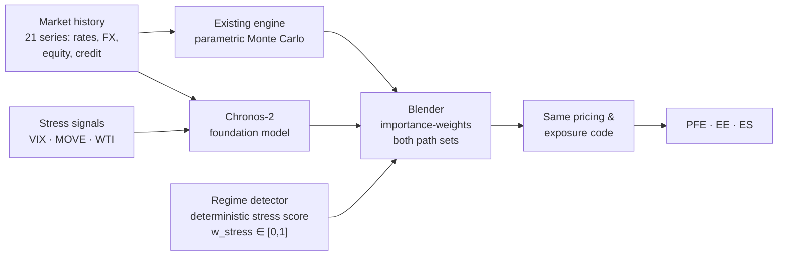
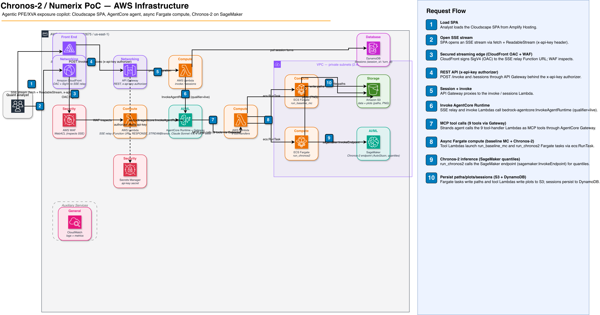

# Chronos-2 × Numerix — Augmenting Monte Carlo Exposure with a Time-Series Foundation Model

A working proof-of-concept showing how **Amazon Chronos-2**, a pretrained
time-series foundation model, can **augment, not replace**, a parametric
Monte Carlo engine for counterparty exposure (PFE / EE / ES, the inputs to
XVA). The existing engine stays the reference. Chronos-2 adds a second,
stress-aware view of the future, and a transparent, deterministic rule
decides how much to trust each one on a given day.

> **Status:** The PoC is complete and has run end-to-end on AWS: quant
> pipeline, live Chronos-2 endpoint, agentic copilot, and web UI. Results
> below are measured against the live endpoint on a **sample cross-asset
> book**. They are directional evidence, not production risk numbers.

---

## Executive summary

### The problem

Parametric Monte Carlo is fast, transparent, and auditable, and it remains
the workhorse for PFE and XVA. Under stress it has known blind spots:

- **Joint tails are too thin.** Gaussian/Cholesky structure understates how
  rates, FX, equity, and credit move together in a crisis.
- **Correlations are static.** A fitted factor covariance cannot represent
  rates–FX or equity–credit correlation flipping mid-stress.
- **Forward-looking signals are left out.** VIX, MOVE, and oil carry stress
  information, but adding them to a PCA + parametric model means
  re-specifying and re-fitting the factor model.

### The idea: "correct + reweight"



1. **Both engines run every time.** The parametric engine and Chronos-2 each
   produce simulated market paths in the same format.
2. **A deterministic regime detector** scores how stressed the market is today
   (`w_stress`, 0 = calm, 1 = stressed) from three inspectable features. It is
   not a black box, and an auditor can see exactly why a date counts as stressed.
3. **A blender reweights paths and never deletes any.** In calm markets the
   parametric engine dominates. In stress, Chronos-2's paths carry more weight
   in the tails.
4. **Downstream code doesn't change.** The same pricing and exposure code
   consumes either path set. The integration surface is one input.

Chronos-2 sees the stress covariates **zero-shot**, with no factor re-fit.
The baseline deliberately does not. That asymmetry is the value being
demonstrated, not a flaw in the baseline.

### What this repo demonstrates

| Evidence | Result | Source |
|---|---|---|
| **Stressed exposure uplift**: live endpoint, as-of 2022-09-30 (2022 rate-hike window), `w_stress ≈ 0.53`, 5,000 paths per engine, 1-year horizon | PFE 97.5%: **$5.61M → $6.63M (+18.3%, +$1.03M)** | [`headline_calibration_5000paths.json`](docs/results/headline_calibration_5000paths.json) |
| **Structural speed**: closed-form exposure on simulated paths vs nested Monte Carlo revaluation (480k revaluations) | **0.28s vs 550s, ≈2,000× faster** | [`latency_benchmark.json`](docs/results/latency_benchmark.json) |
| **Reproducibility**: three independent live runs, pinned data snapshot hashes and container image digests | **Identical to the cent** across all 3 runs | [`live_reproducibility.json`](docs/results/live_reproducibility.json) |
| **Cross-asset reach**: XCCY swaps, equity forwards, and CDS protection over a 21-series rates/FX/equity/credit universe | Correlation breakdown captured **without re-fitting** a factor model | [`src/chronos2_demo/pricing/`](src/chronos2_demo/pricing/) |
| **Conversational what-if**: an analyst asks *"What's my PFE if EUR rates sell off 50bps?"* and an AI copilot conditions Chronos-2 on the scenario and re-prices | Running end-to-end on Amazon Bedrock AgentCore | [`agent/`](agent/), [`frontend/`](frontend/) |

**How to read the +18.3%:** on this sample book in this stress window, the
augmented view says the parametric engine alone **understated 97.5% PFE by
about $1M**. That is the kind of gap a risk manager wants flagged early.

### Where this fits in a risk-analytics portfolio

The "keep your engine as the anchor, add a foundation-model challenger"
pattern isn't specific to PFE. The same blender and reweighting layer applies
wherever a product consumes a path set or scenario set:

| Capability | What Chronos-2 adds | Brief |
|---|---|---|
| **Counterparty exposure / XVA** *(demonstrated here)* | Stress-aware tail paths, covariate conditioning, no factor re-fit | this repo |
| **FRTB IMA expected shortfall** | A challenger ES conditioned on current regime, next to the regulatory stressed-period ES | [`frtb_ima_es.md`](agent/knowledge/frtb_ima_es.md) |
| **Initial / variation margin forecasting** | Regime- and covariate-aware joint P&L quantiles, conditioned on analyst stress narratives | [`im_vm_forecasting.md`](agent/knowledge/im_vm_forecasting.md) |
| **Stress-test design** | Plausible but unseen joint stress paths, and curation of which historical regimes are actually distinct | [`stress_test_design.md`](agent/knowledge/stress_test_design.md) |
| **Scenario-based limits** | A continuous, regime-weighted scenario set alongside predefined shocks, with every path inspectable | [`scenario_limits.md`](agent/knowledge/scenario_limits.md) |
| **Market-data gap filling** | Filling stale or sparse series (EM FX, off-the-run rates) from observed cross-asset features, with uncertainty bands | [`market_data_gap_filling.md`](agent/knowledge/market_data_gap_filling.md) |
| **Long-context and multi-frequency** *(not exercised in the demo)* | Multi-cycle conditioning history; intraday ↔ daily ↔ macro forecasts in one model | [`long_context_windows.md`](agent/knowledge/long_context_windows.md), [`temporal_hierarchies.md`](agent/knowledge/temporal_hierarchies.md) |

In every row the existing model stays the system of record, and the
foundation model is an overlay that flags where it may be optimistic.

### What this is, and what it isn't

**It is:**
- a working, deployed proof of the "augment, not replace" pattern
- a transparent augmentation layer with deterministic, auditable weights
- a drop-in to existing pricing and exposure code, and reproducible run to run

**It isn't (yet):**
- **a production risk number.** It uses a sample book and a curated market
  snapshot, with closed-form pricing proxies rather than full curve builds.
- **backtested.** One stress window (2022-09-30) has been measured so far.
- **a latency SLA.** The ≈2,000× is the structural closed-form-vs-nested-MC
  gap, not a tuned benchmark.
- **an isolated measurement of Chronos-2's own contribution.** The blend
  deliberately tilts weight toward tail paths, so part of the uplift comes
  from the weighting rule itself. Separating the two is the first validation
  step (see [Reading the numbers](#reading-the-numbers)).

### Path to production

1. **Multi-window backtest** across many as-of dates and regimes (2008, 2020,
   2022), with coverage and tail-dependence diagnostics against realized moves.
2. **Attribution study** to separate the foundation model's contribution from
   the stress tilt in the weighting rule.
3. **A broader book**: more instruments, a larger factor universe, and full
   curve-based pricing in place of the closed-form proxies.
4. **Model governance**: validation documentation, monitoring, and
   challenger-model framing for regulators.

---

## For quant engineers

### Architecture

The parametric engine and Chronos-2 each produce a `PathSet`
(`paths: (n_paths, horizon, n_series)`, `weights`, `series`, `dates`) over the
same series, horizon, and dates. That dataclass, in
[`types.py`](src/chronos2_demo/types.py), is the contract every engine emits and
every consumer reads.

- **Engine 1: parametric baseline** ([`models/baseline_mc.py`](src/chronos2_demo/models/baseline_mc.py)).
  PCA on standardized log-returns → AR(1) dynamics per factor (a compact
  stand-in for Hull-White on rates and GBM-style on FX) → joint factor paths
  projected back through the loadings. It is **covariate-blind by design.**
- **Engine 2: Chronos-2** ([`models/chronos2_client.py`](src/chronos2_demo/models/chronos2_client.py)).
  `amazon/chronos-2` is served via AutoGluon Cloud on a serverless SageMaker
  endpoint. It returns **per-series quantiles, not paths**. The client rebuilds
  the joint tensor by inverse-CDF marginal sampling plus a lookback Gaussian
  copula. It ingests VIX/MOVE/WTI as covariates.
- **Regime detector** ([`augmentation/regime_detector.py`](src/chronos2_demo/augmentation/regime_detector.py)).
  `w_stress = mean(pctile(rolling vol), pctile(|FX–rates corr|), pctile(vol-of-vol))`.
  It is deterministic and percentile-ranked within its own history. The stress
  label applies at `w_stress ≥ 0.7`.
- **Blender** ([`augmentation/blender.py`](src/chronos2_demo/augmentation/blender.py)).
  Within each engine, the top and bottom 5% of terminal portfolio P&L form the
  *tail* and the rest is the *body*. Tail mass splits `(1 − w_stress)` parametric
  / `w_stress` Chronos-2, and body mass splits `0.9 / 0.1`. Each engine is
  normalized and the two are combined 50/50. Every path keeps non-zero weight.
- **Pricing and exposure** ([`pricing/`](src/chronos2_demo/pricing/)).
  Closed-form valuation of XCCY swaps, equity forwards, and CDS protection.
  EE/PFE/ES are weighted percentiles over repriced paths. There is no nested
  MC in the hot path. [`nested_mc.py`](src/chronos2_demo/models/nested_mc.py)
  exists **only** as the latency benchmark reference.

### Reading the numbers

- **Two headline runs, both committed, with different settings:**

  | | Headline run | Reproducibility run |
  |---|---|---|
  | Artifact | [`headline_calibration_5000paths.json`](docs/results/headline_calibration_5000paths.json) | [`headline_calibration.json`](docs/results/headline_calibration.json) |
  | Paths per engine | 5,000 | 500 |
  | As-of date / `w_stress` | 2022-09-30 / 0.5305 | 2022-09-30 / 0.5305 |
  | Horizon | 252 business days ¹ | 252 business days |
  | Lookback window | 504 days ¹ | 1,260 days |
  | Code | git `677e485`, original `calibrate_headline.py` | git `eed7dd0`, hashed run spec + pinned provenance |
  | PFE 97.5% baseline → augmented | $5.61M → $6.63M (**+18.3%**) | $4.90M → $5.52M (**+12.6%**) |

  ¹ This is the script default at `677e485`. The original artifact recorded only
  path count, as-of date, and `w_stress`, and no override is recorded.

  Because path count, lookback, and code version all differ, the two numbers
  aren't directly comparable, and the gap shouldn't be read as Monte Carlo noise
  alone. Both runs show the augmented PFE above the baseline. The 500-path run
  is the one that is fully pinned and reproduced three times to the cent. The
  current `calibrate_headline.py` emits only that pinned format, so the
  5,000-path run is a historical artifact, not something the current script
  regenerates as-is.
- **The blend is a stress-tilted measure, not a likelihood-ratio importance
  sampler.** At `w_stress = 0.53`, tail paths end up with roughly 3.4× their
  uniform weight in the parametric engine and roughly 8.4× in Chronos-2. The
  500-path artifact's `diagnostics.attribution` block breaks the result down:
  parametric paths under blend weights give +24.5%, Chronos-2 paths under blend
  weights give −19.8%, and Chronos-2 with uniform weights gives −80.7% (for this
  book and window, its terminal distribution is narrower). The final blend is
  +12.6%. Treat the headline as "what the augmented, stress-tilted view
  reports", and see Path to production step 2.
- **Factor coverage improves.** In the same artifact, 95% band coverage across
  the 21 series rises from 0.84 (baseline) to 0.88 (augmented). USD-cross FX
  pairs are the weakest series for both engines.

### Agentic copilot and UI

An [Amazon Bedrock AgentCore](agent/) runtime hosts a containerized Strands
agent (`us.anthropic.claude-sonnet-4-6`). The agent sequences **9 MCP tools**
through AgentCore Gateway: `load_data`, `run_baseline_mc` / `check_baseline_mc`,
`run_chronos2` / `check_chronos2`, `blend_paths`, `price_book`, `plot`, and
`lookup_use_case`. The two engines run as async ECS Fargate tasks (launch +
poll). A Cloudscape React SPA ([`frontend/`](frontend/)) streams the agent's
replies over SSE and provides a what-if form (as-of date, series shifts,
paths, stress weight). The agent narrates numbers; **it never decides them**.
The quant pipeline is deterministic and runs from a hashed run spec.



Seven CDK stacks (network, storage, tools, agent, api, frontend,
observability) live in [`infra/`](infra/). Deploy, demo, and teardown steps are in
[`docs/runbook.md`](docs/runbook.md).

### Multi-agent experiments

[`experiments/`](experiments/) holds three local, never-deployed experiments on
how much autonomy an LLM layer should have *around* the deterministic quant
core:

- [`hierarchical/`](experiments/hierarchical/): director + specialists vs a
  monolithic agent. Answer pass rate was **0.98 vs 0.65** in live runs, and the
  structural guarantees (routing, state, tool boundaries) held 100%.
- [`react/`](experiments/react/): bounded ReAct for clarification, triage, and
  drill-down.
- [`reflexion/`](experiments/reflexion/): a deterministic-validator + LLM-critic
  loop for faithful narration of run artifacts.

The principle from all three: adaptability, not authority. No LLM ever drives
the quant DAG.

### Quick start

**Prerequisites:** Python 3.11+, AWS credentials able to invoke SageMaker in
`us-east-1`, and a free [FRED API key](https://fred.stlouisfed.org/docs/api/api_key.html).

```bash
git clone <this repo> && cd chronos-2-demo
python3.11 -m venv .venv && source .venv/bin/activate
pip install -e ".[dev]"

# 1. Snapshot market data → data/curated/{panel,covariates}.parquet
python scripts/snapshot_data.py --fred-api-key $FRED_API_KEY

# 2. Deploy Chronos-2 (serverless; scales to zero). Needs: pip install -e ".[deploy]"
python scripts/deploy_chronos2_endpoint.py --action deploy --cache-uri s3://YOUR-BUCKET/fm-cache
#    lower latency alternative: --mode realtime --instance-type ml.g5.xlarge

# 3. Walk the story end-to-end (the PFE overlay in Beat 7 is the key chart)
jupyter lab notebooks/headline_demo.ipynb

# 4. Re-measure the latency benchmark → docs/results/latency_benchmark.json
python scripts/benchmark_latency.py
#    The pinned headline calibration needs a deployed stack's provenance file
#    (data hashes, image digests, endpoint), so it is run from the runbook:
#    python scripts/calibrate_headline.py --profile stage_safe_headline_v1 --provenance-file <file>

# 5. Tear down
python scripts/deploy_chronos2_endpoint.py --action teardown --endpoint-name chronos2-demo-ep
```

The full AWS stack (agent, API, UI) deploys via CDK. See
[`docs/runbook.md`](docs/runbook.md).

### Tests

```bash
pytest -q                                  # core quant package; hermetic, no network or SageMaker
PYTHONPATH=src pytest tools/tests agent/tests -q   # tool Lambdas, Fargate workers, agent
(cd frontend && npm test)                  # SPA (vitest)
(cd infra && CDK_DOCKER=finch npm test)    # CDK snapshot tests (slow)
```

Endpoint and data-fetch calls are mocked. A pinned regression test
(`tests/test_headline_numbers.py`) locks the headline delta on a frozen
synthetic panel. Regenerate it, rarely, with `python tests/fixtures/build_headline_panel.py`.

### Repository layout

```
src/chronos2_demo/       # the quant core
  types.py               #   PathSet: the shared scenario contract
  data/                  #   FRED/ECB fetchers, alignment, covariates, regime labels
  models/                #   parametric MC, Chronos-2 client, nested-MC benchmark
  augmentation/          #   regime detector + blender (the augmentation layer)
  pricing/               #   cross-asset book, closed-form valuation, EE/PFE/ES
  diagnostics/           #   coverage, tail dependence, distribution distance
  plotting/              #   PFE overlay, path fans, regime ribbon
  infra/                 #   Chronos-2 deploy/teardown via AutoGluon Cloud
notebooks/               # headline_demo.ipynb: the executable story
scripts/                 # data snapshot, endpoint deploy, calibration, latency benchmark
agent/                   # AgentCore copilot: tool schemas, system prompt, runtime, use-case briefs
tools/                   # tool implementations: Lambda handlers + Fargate workers
infra/                   # CDK app (7 stacks)
frontend/                # Cloudscape React SPA
experiments/             # multi-agent orchestration experiments (local only)
docs/                    # results, demo materials, runbook, design specs; see docs/README.md
```

### Design decisions worth knowing

- **PathSet is the contract.** It was locked before any engine was written,
  which is why any engine is a drop-in.
- **Augmentation reweights; it never replaces.** No parametric path is ever
  discarded.
- **The covariate asymmetry is intentional.** Giving the baseline VIX/MOVE/WTI
  would erase the comparison the PoC exists to make.
- **Pricing uses closed-form proxies**, not full curve builds. That is out of
  scope for a PoC, and it is also the reason nested MC is unnecessary in the
  hot path.
- **Models narrate; they don't compute.** Every number in the UI comes from the
  deterministic pipeline under a hashed run spec.

---

Further reading: [docs index](docs/README.md) · [design spec](docs/superpowers/specs/2026-05-22-numerix-chronos2-poc-design.md) ·
[slides](docs/demo/slides.md) · [demo script](docs/demo/demo-script.md)

Licensed under the [Apache License 2.0](LICENSE).
