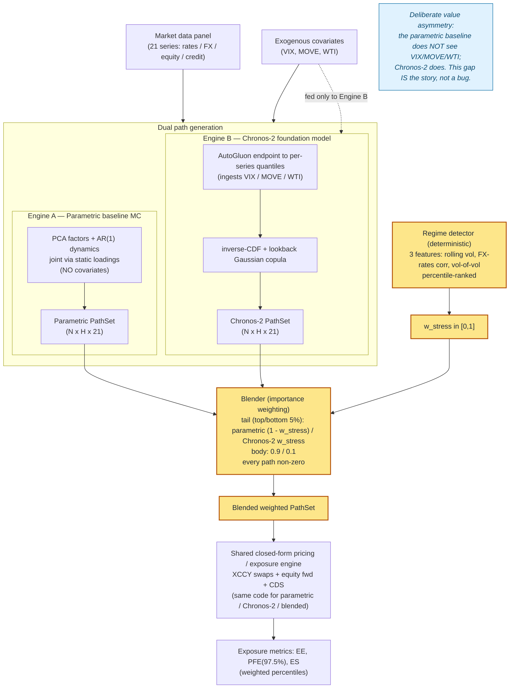
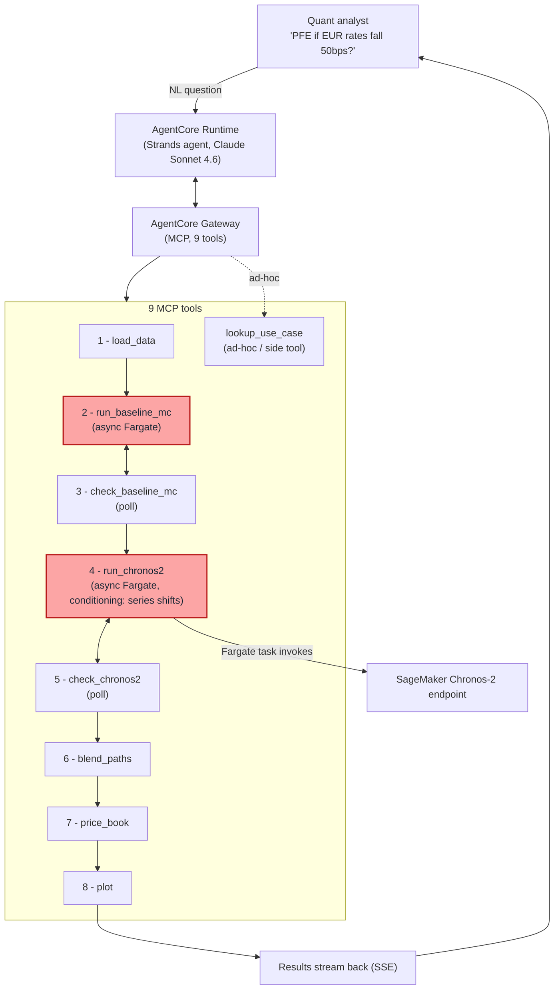

# Chronos-2 / Numerix PoC — Application & Augmentation Flow

## Diagram 1 — The "correct + reweight" augmentation flow

The core quant story: parametric MC and Chronos-2 each produce a full PathSet, a
deterministic regime detector emits `w_stress`, and the blender importance-weights
the two path sets so the *same* downstream pricing/exposure code consumes the result.

## Diagram 2 — Agentic tool orchestration

How the AgentCore copilot sequences the 9 MCP tools for a what-if query. The two
heavy engines (`run_baseline_mc`, `run_chronos2`) follow an async launch-on-Fargate +
poll pattern; results stream back to the analyst over SSE.

