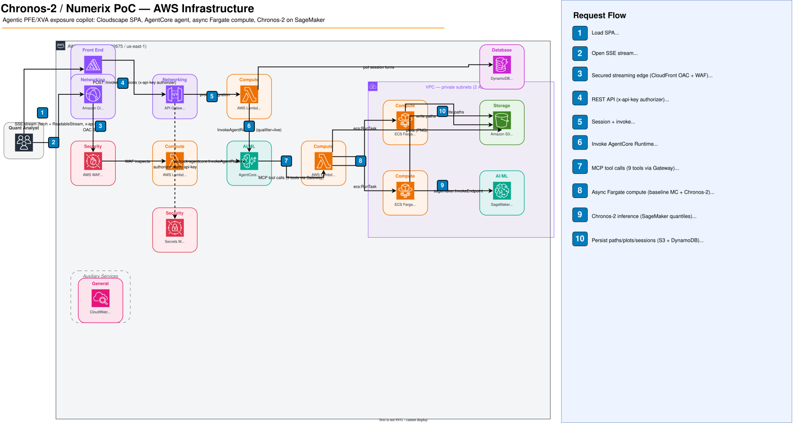

<!-- _class: lead -->

# Chronos-2 with Agentic AI for financial forecasting

## Augmenting hybrid Monte Carlo for PFE/XVA with a time-series foundation model

**Presenter:** <name>
**Date:** 2026-07

<!-- presenter note: Set expectations early — this is a PoC sample book, not a calibrated production system, though the headline is now a live-endpoint measurement. The audience are quants; lead with mechanism, not marketing. -->

---

## The problem: exposure under stress 📉

Parametric Monte Carlo is **fast, transparent, and auditable** — and it remains the workhorse for PFE/XVA. But under stress it has known weak spots:

- **Joint-tail mis-calibration** — Gaussian-copula / Cholesky structure understates co-movement in the far tail.
- **Correlation breakdown** — a static factor covariance can't represent rates–FX or equity–credit correlation flipping in a crisis.
- **No exogenous signal** — VIX, MOVE, WTI carry forward-looking stress information, but they **cannot enter a PCA + parametric model without re-specifying the factor model**.

The question is not "replace MC." It is: **can we add a calibrated correction where parametric MC is weakest?**

---

## The thesis: "correct + reweight" 🎯

> **Chronos-2 augments — does not replace — parametric Monte Carlo by capturing joint-tail dynamics and regime-driven correlation breakdown, improving PFE precision under stress, while the same downstream pricing/exposure code consumes either path set.**

- Both engines produce path sets in the **same tensor contract**.
- A **deterministic** regime detector emits `w_stress ∈ [0,1]`.
- A **blender** importance-weights the paths.
- Chronos-2 always runs **alongside** the baseline — never instead of it.

---

## Architecture at 10,000 ft

**Dual engines → regime detector → blender → shared pricing.** Only the *input path set* to pricing ever changes.



Each stage gets its own slide next. Full detail: [`app-flow.md`](app-flow.md).

---

## Engine 1 — parametric baseline

A conventional joint sampler, deliberately **covariate-blind**:

- **PCA** on standardized daily log-returns → 5 principal factors.
- **AR(1)** dynamics per factor with independent Gaussian shocks — a compact stand-in for Hull-White-style mean reversion (rates) and GBM-style evolution (FX).
- Cross-series correlation comes from the **static PCA loadings**.
- Factor paths are projected back and re-exponentiated to levels.

```text
log-returns → PCA (5 factors) → AR(1) per factor
            → project through loadings → PathSet(n_paths, horizon, n_series)
```

This is the **reference engine** — fast, well-understood, fully auditable. It does **not** ingest VIX/MOVE/WTI intentionally.

---

## Engine 2 — Chronos-2 foundation model

Served as a **serverless AutoGluon Cloud endpoint**. Returns **per-series quantile curves**, not sample paths — so the client reconstructs the joint tensor:

1. **Inverse-CDF marginal sampling** per series from its quantile curve.
2. **Lookback Gaussian copula** couples the marginals cross-series, preserving realized cross-correlation.
3. Output: the same `(n_paths, horizon, n_series)` `PathSet`.

Critically, Chronos-2 **ingests exogenous covariates — VIX, MOVE, WTI — zero-shot**, with no factor re-fit.

<!-- presenter note: Be precise — the endpoint returns marginal quantiles; the JOINT structure is reconstructed client-side. Don't imply the model emits joint paths directly. -->

---

## The asymmetry — and why it's the point ⚖️

| | Parametric baseline | Chronos-2 |
|---|---|---|
| Joint paths | static PCA loadings | inverse-CDF + lookback copula |
| Ingests VIX / MOVE / WTI | **No** | **Yes (zero-shot)** |
| Add a new covariate | re-specify + re-fit | feed it in |

- The baseline **cannot** see VIX/MOVE/WTI without re-specifying the factor model.
- Chronos-2 conditions on them with **no re-fit**.
- This is the **value gap**, not a defect of the baseline. The two engines are meant to disagree precisely where stress signals matter.

---

## Regime detector — deterministic, not a black box 🔍

Three features over a trailing window, each **percentile-ranked within its own history**, then **averaged**:

- **Rolling volatility**
- **FX–rates correlation**
- **Vol-of-vol**

$$ w_{\text{stress}} = \text{mean}\big(\text{pctile}(\sigma),\ \text{pctile}(\rho_{fx,r}),\ \text{pctile}(\text{vov})\big) \in [0,1] $$

- `0` = calm → trust parametric. `1` = stress → lean Chronos-2.
- Default **stress label** threshold: `w_stress ≥ 0.7`.
- Fully **inspectable and reproducible** — auditors can see exactly why a date is "stressed."

---

## Blender — importance weighting ⚙️

Standard importance sampling: **every path keeps non-zero weight; no paths are deleted.**

1. Per engine, compute **terminal portfolio P&L** across all paths.
2. Mark **top/bottom 5%** as the **TAIL**; the rest is the **BODY**.
3. Assign weights, normalize each engine to sum to 1, then **combine 50/50**.

| Region | Parametric weight | Chronos-2 weight |
|---|---|---|
| Tail (±5%) | `1 − w_stress` | `w_stress` |
| Body | `0.9` | `0.1` |

Body weights keep augmentation **visible even when calm**. PFE/EE/ES become **weighted percentiles**.

---

## Shared pricing / exposure engine

**One code path. Three possible inputs.** Only the `PathSet` changes — parametric-only, Chronos-2-only, or blended.

- Closed-form valuation for: **XCCY swaps**, **equity forwards**, **CDS protection**.
- Exposure metrics: **EE**, **PFE**, **ES** — as weighted percentiles over the input paths.
- **No nested Monte Carlo revaluation in the hot path** — closed-form factor-model (FM) pricing.

```text
PathSet (any source) → FM repricing → weighted EE / PFE / ES
```

This is what makes "drop-in" literal: the downstream stack does not know which engine produced the paths.

---

## Cross-asset value — captured zero-shot 🌐

**21-series factor universe:**

| Block | Series |
|---|---|
| Rates | USD/EUR/JPY/GBP at 2Y / 5Y / 10Y |
| FX | 5 major pairs |
| Equity | SPX, NIKKEI |
| Credit | US IG OAS, US HY OAS |

Chronos-2 captures **joint rates–FX correlation breakdown** and **equity/credit co-tail** behavior **zero-shot**. The parametric PCA baseline cannot represent those shifts **without re-fitting the factor model**.

---

## Headline result — live endpoint 📊

Measured against the **live Chronos-2 endpoint** (`chronos2-demo-ep`), as-of **2022-09-30** (2022 rate-hike window), `w_stress ≈ 0.53`:

| Metric | Baseline | Augmented | Δ |
|---|---|---|---|
| PFE (97.5%) | **\$5.61M** | **\$6.63M** | **+18.3%** (+\$1.03M) |

- **N = 5,000 paths/engine**, horizon **252 business days** (1 year; script default, not recorded in the artifact), **21 series**.
- Genuine live-endpoint measurement — **not a mock**. Source: `docs/results/headline_calibration_5000paths.json`.
- **Caveat:** PoC **sample book** on the curated snapshot panel — directional evidence, **not a production risk number**.

<!-- presenter note: This is now a real live-endpoint number. Still say the scope caveat out loud — PoC sample book, not a calibrated production figure. The +18% lift reflects w_stress≈0.53 in the 2022 rate-hike window. -->

---

## Nested-MC benchmark framing ⏱️

- `models/nested_mc.py` exists as a **benchmark reference only** — it is **never wired into the production `compute_metrics`**.
- The production path uses **closed-form FM pricing**, which **avoids expensive nested-MC revaluation**.
- **Measured:** closed-form **0.28s** vs nested-MC **550s** → **≈ 2,000× faster** (480k revaluations; n_paths=200, horizon=12, n_inner=200). Source: `docs/results/latency_benchmark.json`.

> The point is architectural: exposure metrics come from weighted percentiles over repriced paths, not from an inner simulation per outer path. The ~2,000× is illustrative of that structural difference, not a tuned production SLA.

---

## The agentic copilot 🤖

An **Amazon Bedrock AgentCore** copilot — a containerized **Strands** agent on **`us.anthropic.claude-sonnet-4-6`** — orchestrates **9 tools** exposed as **MCP tools** via AgentCore Gateway.

> Analyst: *"What's my PFE if EUR rates sell off 50bps?"* → the agent sequences the tools and conditions Chronos-2 on the scenario.

| | Tools |
|---|---|
| Data | `load_data`, `lookup_use_case` |
| Engines | `run_baseline_mc`, `check_baseline_mc`, `run_chronos2`, `check_chronos2` |
| Pipeline | `blend_paths`, `price_book`, `plot` |

`run_baseline_mc` / `run_chronos2` are **async ECS Fargate** tasks (launch + poll). Supports **end-to-end what-if conditioning** (series shifts / stress scenarios passed to Chronos-2).

---

## AWS infrastructure 🏗️



- **SSE streaming edge:** CloudFront (OAC, SigV4) + **WAF** in front of a Lambda Function URL (`RESPONSE_STREAM`).
- **API:** API Gateway + authorizer (`x-api-key`).
- **Agent:** Bedrock AgentCore Runtime + Gateway (9 MCP tools).
- **Compute:** ECS **Fargate** async workers (baseline MC, Chronos-2 launch/poll).
- **Model:** Chronos-2 via serverless **SageMaker / AutoGluon Cloud** endpoint.
- **State:** **DynamoDB** sessions, **S3** snapshots/artifacts.
- **Frontend:** Cloudscape SPA on **Amplify Hosting** (manual zip deploy).

---

## Live demo — what you'll see 🎬

High-level beats (detailed script: `demo-script.md`):

1. Ask the copilot one natural-language question; watch the **Tool trace panel** light up as it sequences the tools.
2. See the **regime ribbon**, run **both engines** (async Fargate), **blend** and price the book — baseline vs augmented **PFE/EE/ES**.
3. Ask a **natural-language what-if** ("EUR rates −50bps") and watch the agent re-run the tools.

Stage-safe settings: **500 paths/engine**, as-of `2022-09-30`, stress weight `0.5305` — verified live run ≈ 3 min.

| Metric | Baseline | Augmented | Δ |
|---|---:|---:|---:|
| Terminal PFE 97.5% | $4.90M | $5.35M | **+9.08%** |

<!-- presenter note: Use the app-generated values live; the 5,000-path artifact (+18.3%, slide 12) is the higher-path reference run. -->

---

---

## What this is — and isn't ✅

**Is:**
- A working **proof-of-concept** of "augment, not replace."
- A **transparent, auditable** augmentation layer with deterministic weights.
- A **drop-in** to existing closed-form pricing/exposure code.

**Isn't:**
- A production system or a calibrated production risk number — the headline is a **PoC sample book**.
- Backtested across many stress windows yet — one as-of date (2022-09-30) measured so far.
- A tuned production latency SLA — the ~2,000× is the structural closed-form-vs-nested-MC gap.

---

## Roadmap / next steps 🛣️

- **Multi-window backtest** — extend the single live calibration (2022-09-30, +18.3%) across many as-of dates and stress regimes.
- **Broader book** — more instruments, larger factor universe, longer horizons.
- **Production hardening** — model governance, backtesting/coverage, monitoring, SLAs.
- **Validation** — coverage tests, tail-dependence diagnostics, distribution-distance checks against realized stress periods.

---

## Why this matters to quants 🧮

- **(a)** Augmentation, not replacement — drops into existing pricing code.
- **(b)** Transparent, deterministic regime weights — **auditable**, not opaque ML.
- **(c)** Importance sampling is **textbook** — no paths discarded.
- **(d)** **Covariate edge** — VIX/MOVE/WTI zero-shot, which PCA+parametric can't take without re-specification.
- **(e)** **Cross-asset joint tail / correlation breakdown** captured zero-shot.
- **(f)** Reduces reliance on **nested MC**.
- **(g)** **Agentic UX** makes what-if exploration conversational.

---

<!-- _class: lead -->

# Q&A

**Chronos-2 × Numerix — PFE/XVA Augmentation PoC**

_Correct + reweight: augment the tails, keep the pricing code._

Thank you.
